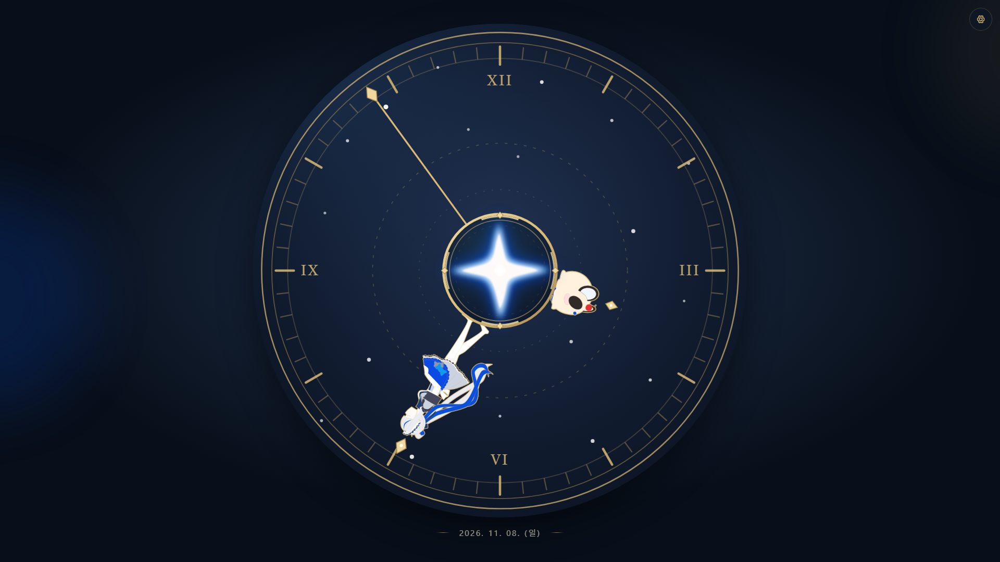
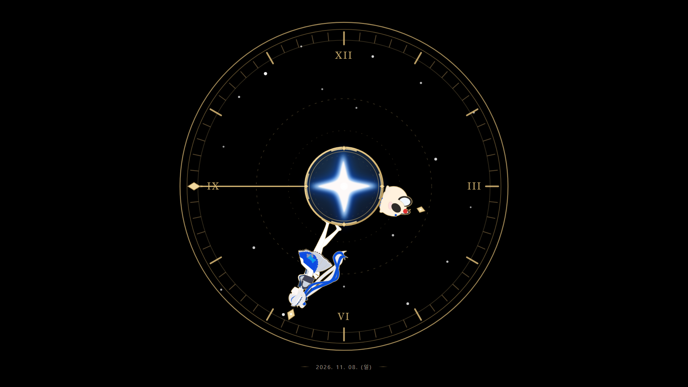

# Rin Clock
⚠️ 비공식 팬메이드 프로젝트 Sakabam-Player is an unofficial fan-made project and is not affiliated with, endorsed by, or sponsored by STELLIVE or Aokumo Rin.

아오쿠모 린과 쿠리미를 시계 바늘로 표현한 비공식 팬메이드 아날로그 웹 시계입니다.

별도의 계정이나 백엔드 없이 브라우저에서 실행되며, 모니터에 상시 띄워두거나 모바일 화면에서 사용할 수 있도록 제작되었습니다.




---

## 소개

Rin Clock은 캐릭터 일러스트와 SVG 시계 다이얼을 결합한 정적 웹 애플리케이션입니다. 시침과 분침을 캐릭터로 표현하고, 배경·발광·외곽선·날짜·초침 표시를 사용자가 조절할 수 있습니다.

주요 목표:

- 별도의 서버 API 없이 동작하는 정적 웹 시계
- SVG 캐릭터와 다이얼을 활용한 고해상도 대응
- 상시 표시 환경에 적합한 간결한 화면 구성
- 사용자 설정의 브라우저 로컬 저장

---

## 목차

1. [주요 특징](#주요-특징)
2. [사용 기술](#사용-기술)
3. [실행 방법](#실행-방법)
4. [사용 방법](#사용-방법)
5. [프로젝트 구조](#프로젝트-구조)
6. [빌드 및 배포](#빌드-및-배포)
7. [Credits & Rights](#credits--rights)

---

## 주요 특징

- **캐릭터 시침·분침:** 아오쿠모 린과 쿠리미를 SVG 기반 시계 바늘로 표시합니다.
- **반응형 아날로그 다이얼:** 금색 링, 눈금, 로마 숫자, 별 장식과 중앙 발광 효과를 화면 크기에 맞게 표시합니다.
- **발광 효과 선택:** 기본 WebP 광원과 SVG 기반 선명한 발광 효과 중 선택할 수 있습니다.
- **검정 배경:** 푸른 배경 효과를 끄고 검정색 배경으로 전환할 수 있습니다.
- **Bold 외곽선:** 캐릭터의 금색 외곽선이 강화된 SVG를 선택할 수 있습니다.
- **표시 옵션:** 초침과 날짜 표시를 개별적으로 켜고 끌 수 있습니다.
- **설정 버튼 자동 숨김:** 기본값은 OFF이며, 활성화하면 버튼을 숨기고 우측 상단 호버·터치 또는 `S` 키로 설정에 접근할 수 있습니다.
- **로컬 설정 저장:** 설정은 브라우저 `localStorage`에 저장됩니다.
- **저부하 갱신:** 초 단위로 시간을 갱신합니다.

---

## 사용 기술

| 분류 | 기술 |
| --- | --- |
| 프런트엔드 | HTML, CSS, Vanilla JavaScript |
| 그래픽 | SVG, WebP |
| 빌드 | Vite |
| 설정 저장 | Web Storage API (`localStorage`) |
| 배포 | 정적 호스팅 (예: Cloudflare Pages) |

런타임에 별도의 백엔드나 외부 API가 필요하지 않습니다.

---

## 실행 방법

Node.js 및 npm이 설치된 환경에서 저장소를 클론하거나 다운로드한 뒤 프로젝트 루트에서 실행합니다.

```powershell
npm ci
npm run dev
```

터미널에 표시된 Vite 개발 서버 주소로 접속합니다.

배포용 파일 생성:

```powershell
npm run build
```

빌드 결과 확인:

```powershell
npm run preview
```

`dist/`는 빌드 시 자동으로 생성됩니다.

---

## 사용 방법

화면 우측 상단의 톱니바퀴 버튼으로 설정을 엽니다.

| 설정 | 기본값 | 설명 |
| --- | --- | --- |
| 초침 | ON | 초침 표시 여부 |
| Bold 외곽선 | OFF | 캐릭터 외곽선 강화 |
| 날짜 표시 | ON | 시계 아래 날짜 표시 |
| 발광 효과 선명화 | OFF | WebP 발광과 SVG 발광 전환 |
| 배경 끄기 | OFF | 푸른 배경 대신 검정 배경 표시 |
| 설정 버튼 자동 숨김 | OFF | 설정 버튼을 평소 숨김 |

설정 버튼 자동 숨김을 켠 경우, 우측 상단에 마우스를 올리거나 해당 위치를 터치해 버튼에 접근할 수 있습니다. `S` 키로도 설정 창을 열고 닫을 수 있습니다. 설정값은 동일한 브라우저의 로컬 저장소에 보관됩니다.

---

## 프로젝트 구조

```text
Rin-Clock/
├── docs/
│   ├── Rin-Clock-preview-blue.png
│   ├── Rin-Clock-preview-black.png
│   └── source/                 # 제작용 SVG 원본
├── src/
│   ├── index.html
│   ├── css/style.css
│   ├── js/clock.js
│   └── public/assets/          # 빌드 시 정적으로 복사되는 이미지
├── vite.config.js
├── package.json
├── package-lock.json
├── .gitignore
└── README.md
```

`src/public/assets/`의 SVG와 WebP는 Vite 빌드 과정에서 배포 폴더로 복사됩니다. 제작용 원본은 `docs/source/`에 별도로 보관합니다.

---

## 빌드 및 배포

Vite는 JavaScript와 CSS를 빌드 및 압축하고, 정적 에셋은 그대로 복사합니다. HTML 추가 Minify는 프로젝트의 `vite.config.js`에 별도 후처리 설정이 적용된 경우에만 수행됩니다.

Cloudflare Pages의 Git 저장소 연결 시 예시 설정:

| 항목 | 값 |
| --- | --- |
| 빌드 명령 | `npm run build` |
| 출력 디렉터리 | `dist` |
| 프로젝트 루트 | 저장소 루트 |

정적 파일을 사이트의 루트 경로에 배포하는 구성을 기준으로 합니다.

---

## Credits & Rights

이 프로젝트는 **비공식 팬메이드 프로젝트**이며, 아오쿠모 린 및 관련 캐릭터의 공식 서비스가 아닙니다. 캐릭터와 관련 원본 일러스트의 권리는 각 권리자에게 귀속됩니다.

웹 구현에는 Vite 및 브라우저 표준 API를 사용합니다. 사용된 개발 의존성의 라이선스는 각 패키지의 라이선스를 따릅니다.

**저장소를 공개한다고 해서 캐릭터 이미지와 관련 에셋의 재배포·상업적 이용이 자동으로 허용되는 것은 아닙니다.** 해당 콘텐츠의 공개 및 재사용에는 권리자의 가이드라인과 허락 범위를 확인해야 합니다. 프로젝트 전체에 적용할 별도 라이선스는 명시하지 않았습니다.
